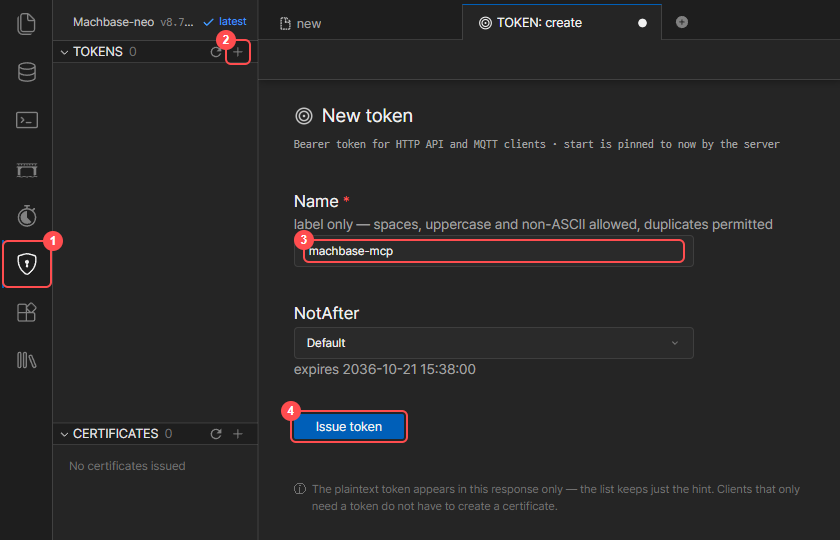
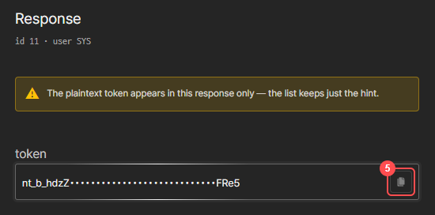

# Machbase MCP Server v0.8.0

[English](README.MD) | [한국어](README.kr.md) | [日本語](README.ja.md)


## Overview
[Blog (Korean): 클로드 MCP를 Machbase Neo에 연동하고, AI스럽게 사용해보기](https://www.machbase.com/post/machbase)

This project is an **MCP (Model Context Protocol)** based server that enables natural language-based database operations through integration between **Claude Desktop** and **Machbase Neo**.

When users request database operations in natural language through Claude Desktop's MCP connection, the MCP server converts these requests into Machbase Neo commands and executes them.

[](https://youtu.be/8cpaMTNHHiI?si=MX4tQK6Enh16hIUA)

### Key Features

* **Machbase Neo Official Documentation Search & AI-powered Explanations**
  * Claude directly searches Machbase documentation to provide accurate information
* **Real-time Database Integration** 
  * Table creation, data manipulation, complex query execution
  * Natural language → SQL conversion through Claude
* **Time Series Data Analysis & Querying**
  * Analysis of IoT sensor data, log data, and other time series data
* **Native Claude Desktop Integration**
  * No LLM API key required, leverages Claude Desktop's built-in capabilities

### How It Works

| Step | Component | Role | Communication |
|------|-----------|------|---------------|
| 1 | User | Input natural language request | Chat interface |
| 2 | Claude Desktop | Parse request & call MCP tools | MCP Protocol |
| 3 | MCP Server | Generate SQL & connect to Machbase | HTTP API (Neo API token) |
| 4 | Machbase Neo | Execute database operations | SQL queries |

**Data Flow:**

```
User Request → Claude Desktop → MCP Server → Machbase Neo
↑                                                      ↓
Response ← Claude Interpretation ← MCP Response ← Query Results
```

## Requirements

* **Machbase Neo 8.7.2 or later**, started with token authentication enabled
  ```bash
  machbase-neo serve --http-enable-token-auth true
  ```
* **A Machbase Neo API token** (see [Issue a Neo API Token](#issue-a-neo-api-token))
* **Claude Desktop** for Windows, macOS, or Linux (beta, Ubuntu 22.04+ / Debian 12+)
  * https://claude.ai/download

## Issue a Neo API Token

1. Open the Machbase Neo web console (`http://<neo-host>:5654`) and sign in.
2. Click the shield icon **①**, then the **+** button next to **TOKENS** **②**.
3. Enter a name for the token **③** (e.g. `machbase-mcp`) and click **Issue token** **④**.

   

4. Copy the issued token with the copy button **⑤**.

   

> The plaintext token is shown only once. If you lose it, issue a new token.

## Installation

### Quick Setup

#### Windows
1. **Install Claude Desktop and launch it once**
    * https://claude.ai/download

2. **Download project from Git**
   ```bash
   git clone https://github.com/machbase/machbase-mcp-server.git
   cd machbase-mcp-server/Machbase_MCP_Sever
   ```

3. **Run automatic installation**
   ```bash
   MCP_Install.bat
   ```

4. **Set your Neo API token**
   * Open the `claude_desktop_config.json` file shown at the end of the installation.
   * Replace `YOUR_NEO_API_TOKEN` with the token you issued.
   * Fully quit Claude Desktop (including the system tray icon) and start it again.

#### macOS
1. **Download project from Git**
   ```bash
   git clone https://github.com/machbase/machbase-mcp-server.git
   cd machbase-mcp-server/Machbase_MCP_Sever
   ```

2. **Run automatic installation**
   ```bash
   ./MCP_Install_mac.sh
   ```

3. **Set your Neo API token**
   * Replace `YOUR_NEO_API_TOKEN` in `~/Library/Application Support/Claude/claude_desktop_config.json` with the token you issued.
   * Quit Claude Desktop and start it again.

#### Linux
1. **Download project from Git**
   ```bash
   git clone https://github.com/machbase/machbase-mcp-server.git
   cd machbase-mcp-server/Machbase_MCP_Sever
   ```

2. **Run automatic installation**
   ```bash
   ./MCP_Install_linux.sh
   ```

3. **Set your Neo API token**
   * Replace `YOUR_NEO_API_TOKEN` in `~/.config/Claude/claude_desktop_config.json` with the token you issued.
   * Quit Claude Desktop and start it again.

> **After installation**: Test with "Show me the Machbase table list!"

The installer adds only the `machbase` server to `claude_desktop_config.json` and keeps your other MCP servers and settings. Running it again to update keeps the token you already set.

### Config File Location

| OS | `claude_desktop_config.json` |
|----|------------------------------|
| Windows (Microsoft Store install) | `%LOCALAPPDATA%\Packages\Claude_pzs8sxrjxfjjc\LocalCache\Roaming\Claude\` |
| Windows (other installs) | `%APPDATA%\Claude\` |
| macOS | `~/Library/Application Support/Claude/` |
| Linux | `~/.config/Claude/` |

### Manual Setup

For manual installation or if errors occur during the above installation process:

1. **Clone Repository**
   ```bash
   git clone https://github.com/machbase/machbase-mcp-server.git
   cd machbase-mcp-server/Machbase_MCP_Sever
   ```

2. **Python Environment Setup**
   ```bash
   # Using Conda
   conda create -n mcp python=3.11
   conda activate mcp
   
   # Using venv
   python -m venv mcp-env
   source mcp-env/bin/activate  # Linux/macOS
   # mcp-env\Scripts\activate   # Windows
   ```

3. **Install Dependencies**
   ```bash
   pip install -r requirements.txt
   ```

4. **Claude Desktop and MCP Server Configuration**
   * Copy `Machbase.py` and the `neo` folder to the Claude config folder (see [Config File Location](#config-file-location)).
   * Add the `machbase` server to `claude_desktop_config.json` in the same folder:

   ```json
   {
     "mcpServers": {
       "machbase": {
         "command": "C:/Users/<Username>/anaconda3/envs/mcp/python.exe",
         "args": ["C:/Users/<Username>/AppData/Roaming/Claude/Machbase.py"],
         "env": {
           "MACHBASE_HOST": "localhost",
           "MACHBASE_PORT": "5654",
           "MACHBASE_TOKEN": "<your Neo API token>"
         }
       }
     }
   }
   ```

   | Variable | Description | Default |
   |----------|-------------|---------|
   | `MACHBASE_HOST` | Machbase Neo host | `127.0.0.1` |
   | `MACHBASE_PORT` | Machbase Neo HTTP port | `5654` |
   | `MACHBASE_TOKEN` | Machbase Neo API token | (required) |

### Usage Examples ###

You can make natural language requests in Claude Desktop like these:

```text
"Create a table for temperature logs"
"Insert today's temperature: 28.4°C at 9am"
"Show me the latest 10 rows from temperature_log"
"Search the Machbase documentation for 'data insertion'"
"Drop the table named old_sensor_data"
"Show average temperature over the past 3 days"
"What tables exist in my Machbase database?"
"List all columns in sensor_data"
"Generate a trend report for device_001"
```

### Machbase MCP Server Evaluation Score ###

| Update Date| Version | Score | Average Response Time | Overall Evaluation | Model | 
|:------:|:----:|:----:|:--------:|-------------| :-------------:|
| 2025-08-28| v0.2.0 | 96 / 100 | 22 second | The quality of responses has improved compared to previous versions; <br> however, performance regarding TQL-related questions still appears to be less than perfect. | Claude Sonnet 4 |
| 2025-09-03| v0.3.0 | 99 / 100 | 61.5 second | The response time is much longer, but the explanation is far more accurate and detailed than the previous version. | Claude Sonnet 4 | 
| 2025-09-09| v0.4.0 | 141 / 150   | 45.29 second | The speed has improved compared to before, but the script and TQL parts are still somewhat lacking| Claude Sonnet 4 |
| 2025-10-14| v0.5.0 | 185 / 200   | 3 second | Thinking time significantly improved compared to before, but TQL and HTML-related areas still need improvement. | Claude Sonnet 4.5 |
| 2025-10-24| v0.6.0 | 196 / 200   | 2.6 second | Improved accuracy compared to version 0.5.0. DBMS-related content needs re-verification. Overall performance and response time have improved significantly. | Claude Sonnet 4.5 |
| 2026-02-25| v0.7.0 | 198 / 200   | 6.7 second | The enhanced execution verification feature visibly compensates for code answer mistakes; accuracy has improved compared to the previous version (0.6.x) | Claude Sonnet 4.6 |
