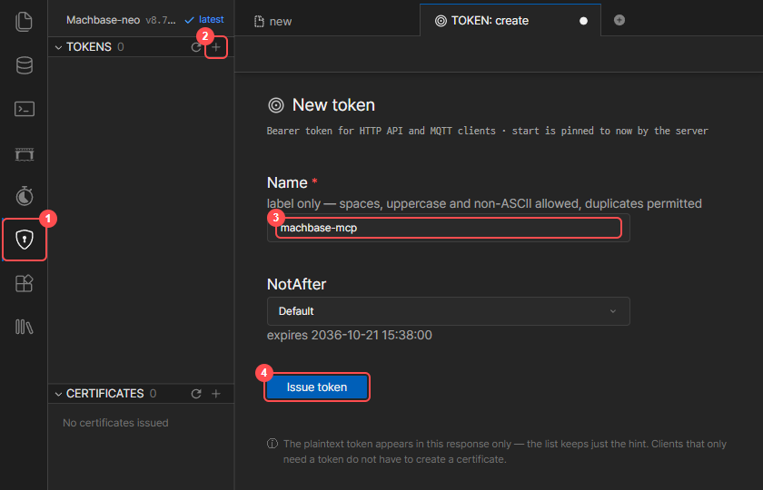
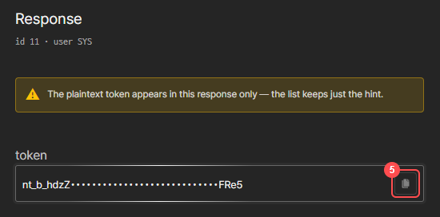

# Machbase MCP Server v0.8.0

[English](README.MD) | [한국어](README.kr.md) | [日本語](README.ja.md)


## 概要
[ブログ（韓国語）: 클로드 MCP를 Machbase Neo에 연동하고, AI스럽게 사용해보기](https://www.machbase.com/post/machbase)

このプロジェクトは、**Claude Desktop** と **Machbase Neo** を連携させ、自然言語でデータベースを操作できるようにする **MCP (Model Context Protocol)** サーバーです。

Claude Desktop の MCP 接続を通じて自然言語でリクエストすると、MCP サーバーがそれを Machbase Neo のコマンドに変換して実行します。

[](https://youtu.be/8cpaMTNHHiI?si=MX4tQK6Enh16hIUA)

### 主な機能

* **Machbase Neo 公式ドキュメントの検索と AI による解説**
  * Claude が Machbase のドキュメントを直接検索し、正確な情報を提供します
* **リアルタイムのデータベース連携**
  * テーブル作成、データ操作、複雑なクエリの実行
  * Claude による自然言語 → SQL 変換
* **時系列データの分析と照会**
  * IoT センサーデータやログデータなど、時系列データの分析
* **Claude Desktop とのネイティブ統合**
  * LLM の API キーは不要で、Claude Desktop に組み込まれた機能をそのまま利用します

### 仕組み

| ステップ | コンポーネント | 役割 | 通信 |
|------|-----------|------|------|
| 1 | ユーザー | 自然言語でリクエストを入力 | チャット画面 |
| 2 | Claude Desktop | リクエストを解釈し MCP ツールを呼び出す | MCP プロトコル |
| 3 | MCP サーバー | SQL を生成し Machbase に接続 | HTTP API (Neo API トークン) |
| 4 | Machbase Neo | データベース操作を実行 | SQL クエリ |

**データの流れ:**

```
ユーザーのリクエスト → Claude Desktop → MCP サーバー → Machbase Neo
↑                                                                ↓
応答 ← Claude の解釈 ← MCP の応答 ← クエリ結果
```

## 動作要件

* **Machbase Neo 8.7.2 以降**（トークン認証を有効にして起動）
  ```bash
  machbase-neo serve --http-enable-token-auth true
  ```
* **Machbase Neo API トークン**（[Neo API トークンの発行](#neo-api-トークンの発行) を参照）
* **Claude Desktop**: Windows、macOS、Linux（ベータ版、Ubuntu 22.04+ / Debian 12+）
  * https://claude.ai/download

## Neo API トークンの発行

1. Machbase Neo の Web コンソール（`http://<neo-host>:5654`）を開いてサインインします。
2. 盾アイコン **①** をクリックし、**TOKENS** の横にある **+** ボタン **②** をクリックします。
3. トークン名 **③**（例: `machbase-mcp`）を入力し、**Issue token** **④** をクリックします。

   

4. 発行されたトークンを、コピーボタン **⑤** でコピーします。

   

> 平文のトークンは発行時に一度だけ表示されます。紛失した場合は、新しいトークンを発行してください。

## インストール

### クイックセットアップ

#### Windows
1. **Claude Desktop をインストールし、一度起動します**
    * https://claude.ai/download

2. **Git からプロジェクトをダウンロード**
   ```bash
   git clone https://github.com/machbase/machbase-mcp-server.git
   cd machbase-mcp-server/Machbase_MCP_Sever
   ```

3. **自動インストールを実行**
   ```bash
   MCP_Install.bat
   ```

4. **Neo API トークンを設定**
   * インストールの最後に表示される `claude_desktop_config.json` ファイルを開きます。
   * `YOUR_NEO_API_TOKEN` を、発行したトークンに置き換えます。
   * Claude Desktop をシステムトレイのアイコンも含めて完全に終了し、再起動します。

#### macOS
1. **Git からプロジェクトをダウンロード**
   ```bash
   git clone https://github.com/machbase/machbase-mcp-server.git
   cd machbase-mcp-server/Machbase_MCP_Sever
   ```

2. **自動インストールを実行**
   ```bash
   ./MCP_Install_mac.sh
   ```

3. **Neo API トークンを設定**
   * `~/Library/Application Support/Claude/claude_desktop_config.json` の `YOUR_NEO_API_TOKEN` を、発行したトークンに置き換えます。
   * Claude Desktop を終了し、再起動します。

#### Linux
1. **Git からプロジェクトをダウンロード**
   ```bash
   git clone https://github.com/machbase/machbase-mcp-server.git
   cd machbase-mcp-server/Machbase_MCP_Sever
   ```

2. **自動インストールを実行**
   ```bash
   ./MCP_Install_linux.sh
   ```

3. **Neo API トークンを設定**
   * `~/.config/Claude/claude_desktop_config.json` の `YOUR_NEO_API_TOKEN` を、発行したトークンに置き換えます。
   * Claude Desktop を終了し、再起動します。

> **インストール後**: 「Machbase のテーブル一覧を見せて!」と聞いて、動作を確認してください。

インストーラーは `claude_desktop_config.json` に `machbase` サーバーだけを追加し、ほかの MCP サーバーや設定はそのまま残します。更新のために再実行しても、設定済みのトークンは保持されます。

### 設定ファイルの場所

| OS | `claude_desktop_config.json` |
|----|------------------------------|
| Windows（Microsoft Store 版） | `%LOCALAPPDATA%\Packages\Claude_pzs8sxrjxfjjc\LocalCache\Roaming\Claude\` |
| Windows（その他のインストール） | `%APPDATA%\Claude\` |
| macOS | `~/Library/Application Support/Claude/` |
| Linux | `~/.config/Claude/` |

### 手動セットアップ

上記のインストールでエラーが発生した場合や、手動でインストールする場合:

1. **リポジトリをクローン**
   ```bash
   git clone https://github.com/machbase/machbase-mcp-server.git
   cd machbase-mcp-server/Machbase_MCP_Sever
   ```

2. **Python 環境の準備**
   ```bash
   # Conda を使う場合
   conda create -n mcp python=3.11
   conda activate mcp
   
   # venv を使う場合
   python -m venv mcp-env
   source mcp-env/bin/activate  # Linux/macOS
   # mcp-env\Scripts\activate   # Windows
   ```

3. **依存パッケージのインストール**
   ```bash
   pip install -r requirements.txt
   ```

4. **Claude Desktop と MCP サーバーの設定**
   * `Machbase.py` と `neo` フォルダーを Claude の設定フォルダーにコピーします（[設定ファイルの場所](#設定ファイルの場所) を参照）。
   * 同じフォルダーの `claude_desktop_config.json` に `machbase` サーバーを追加します。

   ```json
   {
     "mcpServers": {
       "machbase": {
         "command": "C:/Users/<Username>/anaconda3/envs/mcp/python.exe",
         "args": ["C:/Users/<Username>/AppData/Roaming/Claude/Machbase.py"],
         "env": {
           "MACHBASE_HOST": "localhost",
           "MACHBASE_PORT": "5654",
           "MACHBASE_TOKEN": "<発行した Neo API トークン>"
         }
       }
     }
   }
   ```

   | 変数 | 説明 | 既定値 |
   |------|------|--------|
   | `MACHBASE_HOST` | Machbase Neo のホスト | `127.0.0.1` |
   | `MACHBASE_PORT` | Machbase Neo の HTTP ポート | `5654` |
   | `MACHBASE_TOKEN` | Machbase Neo API トークン | （必須） |

### 使用例 ###

Claude Desktop では、次のように自然言語でリクエストできます。

```text
"温度ログ用のテーブルを作成して"
"今日の午前 9 時の温度 28.4°C を登録して"
"temperature_log の最新 10 行を見せて"
"Machbase のドキュメントで「データ入力」を検索して"
"old_sensor_data テーブルを削除して"
"過去 3 日間の平均温度を見せて"
"Machbase データベースにはどんなテーブルがある?"
"sensor_data のカラムをすべて表示して"
"device_001 のトレンドレポートを作成して"
```

### Machbase MCP サーバーの評価スコア ###

| 更新日 | バージョン | スコア | 平均応答時間 | 総合評価 | モデル | 
|:------:|:----:|:----:|:--------:|-------------| :-------------:|
| 2025-08-28| v0.2.0 | 96 / 100 | 22 秒 | 以前のバージョンより回答の品質は向上しましたが、<br> TQL 関連の質問ではまだ完全とはいえません。 | Claude Sonnet 4 |
| 2025-09-03| v0.3.0 | 99 / 100 | 61.5 秒 | 応答時間は大幅に長くなりましたが、説明は以前のバージョンよりはるかに正確で詳細です。 | Claude Sonnet 4 | 
| 2025-09-09| v0.4.0 | 141 / 150   | 45.29 秒 | 速度は以前より向上しましたが、スクリプトと TQL の部分はまだやや不十分です。 | Claude Sonnet 4 |
| 2025-10-14| v0.5.0 | 185 / 200   | 3 秒 | 思考時間は以前より大幅に短縮されましたが、TQL と HTML 関連の部分はまだ改善が必要です。 | Claude Sonnet 4.5 |
| 2025-10-24| v0.6.0 | 196 / 200   | 2.6 秒 | 0.5.0 より精度が向上しました。DBMS 関連の内容は再検証が必要です。全体的な性能と応答時間が大きく改善されました。 | Claude Sonnet 4.5 |
| 2026-02-25| v0.7.0 | 198 / 200   | 6.7 秒 | 強化された実行検証機能がコード回答のミスを目に見えて補い、以前のバージョン（0.6.x）より精度が向上しました。 | Claude Sonnet 4.6 |
