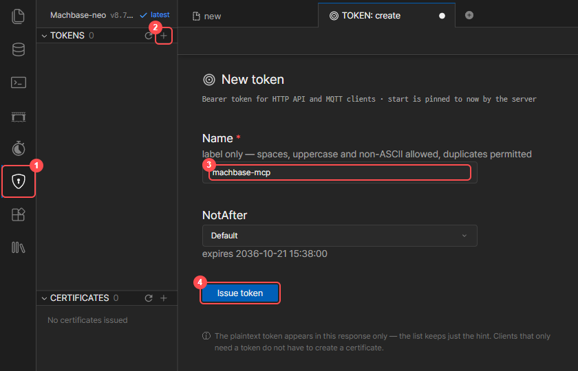
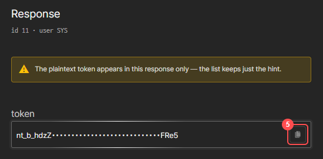

# Machbase MCP Server v0.8.0

[English](README.MD) | [한국어](README.kr.md) | [日本語](README.ja.md)


## 개요
[블로그 읽기 : 클로드 MCP를 Machbase Neo에 연동하고, AI스럽게 사용해보기](https://www.machbase.com/post/machbase)

이 프로젝트는 **Claude Desktop**과 **Machbase Neo**를 연결해 자연어로 데이터베이스를 다룰 수 있게 해 주는 **MCP(Model Context Protocol)** 서버입니다.

Claude Desktop의 MCP 연결로 자연어 요청을 보내면, MCP 서버가 그 요청을 Machbase Neo 명령으로 바꿔 실행합니다.

[](https://youtu.be/8cpaMTNHHiI?si=MX4tQK6Enh16hIUA)

### 주요 기능

* **Machbase Neo 공식 문서 검색과 AI 설명**
  * Claude가 Machbase 문서를 직접 찾아 정확한 정보를 알려 줍니다
* **실시간 데이터베이스 연동**
  * 테이블 생성, 데이터 조작, 복잡한 쿼리 실행
  * Claude를 통한 자연어 → SQL 변환
* **시계열 데이터 분석과 조회**
  * IoT 센서 데이터, 로그 데이터 등 시계열 데이터 분석
* **Claude Desktop 기본 통합**
  * LLM API 키가 필요 없고, Claude Desktop에 내장된 기능을 그대로 사용합니다

### 동작 방식

| 단계 | 구성 요소 | 역할 | 통신 |
|------|-----------|------|------|
| 1 | 사용자 | 자연어 요청 입력 | 채팅 화면 |
| 2 | Claude Desktop | 요청 해석 및 MCP 도구 호출 | MCP 프로토콜 |
| 3 | MCP 서버 | SQL 생성 및 Machbase 연결 | HTTP API (Neo API 토큰) |
| 4 | Machbase Neo | 데이터베이스 작업 실행 | SQL 쿼리 |

**데이터 흐름:**

```
사용자 요청 → Claude Desktop → MCP 서버 → Machbase Neo
↑                                                   ↓
응답 ← Claude 해석 ← MCP 응답 ← 쿼리 결과
```

## 요구 사항

* **Machbase Neo 8.7.2 이상**, 토큰 인증을 켠 상태로 실행
  ```bash
  machbase-neo serve --http-enable-token-auth true
  ```
* **Machbase Neo API 토큰** ([Neo API 토큰 발급](#neo-api-토큰-발급) 참고)
* **Claude Desktop**: Windows, macOS, Linux(베타, Ubuntu 22.04+ / Debian 12+)
  * https://claude.ai/download

## Neo API 토큰 발급

1. Machbase Neo 웹 콘솔(`http://<neo-host>:5654`)을 열고 로그인합니다.
2. 방패 아이콘(**①**)을 누른 뒤, **TOKENS** 옆의 **+** 버튼(**②**)을 누릅니다.
3. 토큰 이름(**③**, 예: `machbase-mcp`)을 입력하고 **Issue token**(**④**)을 누릅니다.

   

4. 발급된 토큰을 복사 버튼(**⑤**)으로 복사합니다.

   

> 평문 토큰은 발급할 때 한 번만 표시됩니다. 잃어버렸다면 새로 발급하세요.

## 설치

### 빠른 설치

#### Windows
1. **Claude Desktop을 설치하고 한 번 실행합니다**
    * https://claude.ai/download

2. **Git에서 프로젝트 내려받기**
   ```bash
   git clone https://github.com/machbase/machbase-mcp-server.git
   cd machbase-mcp-server/Machbase_MCP_Sever
   ```

3. **자동 설치 실행**
   ```bash
   MCP_Install.bat
   ```

4. **Neo API 토큰 설정**
   * 설치가 끝날 때 표시되는 `claude_desktop_config.json` 파일을 엽니다.
   * `YOUR_NEO_API_TOKEN`을 발급받은 토큰으로 바꿉니다.
   * Claude Desktop을 시스템 트레이 아이콘까지 완전히 종료한 뒤 다시 실행합니다.

#### macOS
1. **Git에서 프로젝트 내려받기**
   ```bash
   git clone https://github.com/machbase/machbase-mcp-server.git
   cd machbase-mcp-server/Machbase_MCP_Sever
   ```

2. **자동 설치 실행**
   ```bash
   ./MCP_Install_mac.sh
   ```

3. **Neo API 토큰 설정**
   * `~/Library/Application Support/Claude/claude_desktop_config.json`의 `YOUR_NEO_API_TOKEN`을 발급받은 토큰으로 바꿉니다.
   * Claude Desktop을 종료한 뒤 다시 실행합니다.

#### Linux
1. **Git에서 프로젝트 내려받기**
   ```bash
   git clone https://github.com/machbase/machbase-mcp-server.git
   cd machbase-mcp-server/Machbase_MCP_Sever
   ```

2. **자동 설치 실행**
   ```bash
   ./MCP_Install_linux.sh
   ```

3. **Neo API 토큰 설정**
   * `~/.config/Claude/claude_desktop_config.json`의 `YOUR_NEO_API_TOKEN`을 발급받은 토큰으로 바꿉니다.
   * Claude Desktop을 종료한 뒤 다시 실행합니다.

> **설치 후**: "Machbase 테이블 목록 보여줘!"라고 물어 확인해 보세요.

설치 스크립트는 `claude_desktop_config.json`에 `machbase` 서버만 추가하고, 다른 MCP 서버와 설정은 그대로 둡니다. 업데이트하려고 다시 실행해도 이미 넣어 둔 토큰은 유지됩니다.

### 설정 파일 위치

| OS | `claude_desktop_config.json` |
|----|------------------------------|
| Windows (Microsoft Store 설치) | `%LOCALAPPDATA%\Packages\Claude_pzs8sxrjxfjjc\LocalCache\Roaming\Claude\` |
| Windows (그 밖의 설치) | `%APPDATA%\Claude\` |
| macOS | `~/Library/Application Support/Claude/` |
| Linux | `~/.config/Claude/` |

### 수동 설치

위 설치 과정에서 오류가 나거나 직접 설치하려는 경우:

1. **저장소 복제**
   ```bash
   git clone https://github.com/machbase/machbase-mcp-server.git
   cd machbase-mcp-server/Machbase_MCP_Sever
   ```

2. **Python 환경 준비**
   ```bash
   # Conda 사용
   conda create -n mcp python=3.11
   conda activate mcp
   
   # venv 사용
   python -m venv mcp-env
   source mcp-env/bin/activate  # Linux/macOS
   # mcp-env\Scripts\activate   # Windows
   ```

3. **의존성 설치**
   ```bash
   pip install -r requirements.txt
   ```

4. **Claude Desktop과 MCP 서버 설정**
   * `Machbase.py`와 `neo` 폴더를 Claude 설정 폴더에 복사합니다([설정 파일 위치](#설정-파일-위치) 참고).
   * 같은 폴더의 `claude_desktop_config.json`에 `machbase` 서버를 추가합니다.

   ```json
   {
     "mcpServers": {
       "machbase": {
         "command": "C:/Users/<Username>/anaconda3/envs/mcp/python.exe",
         "args": ["C:/Users/<Username>/AppData/Roaming/Claude/Machbase.py"],
         "env": {
           "MACHBASE_HOST": "localhost",
           "MACHBASE_PORT": "5654",
           "MACHBASE_TOKEN": "<발급받은 Neo API 토큰>"
         }
       }
     }
   }
   ```

   | 변수 | 설명 | 기본값 |
   |------|------|--------|
   | `MACHBASE_HOST` | Machbase Neo 호스트 | `127.0.0.1` |
   | `MACHBASE_PORT` | Machbase Neo HTTP 포트 | `5654` |
   | `MACHBASE_TOKEN` | Machbase Neo API 토큰 | (필수) |

### 사용 예시 ###

Claude Desktop에서 이렇게 자연어로 요청할 수 있습니다.

```text
"온도 로그용 테이블을 만들어 줘"
"오늘 오전 9시 온도 28.4°C를 넣어 줘"
"temperature_log에서 최근 10개 행을 보여 줘"
"Machbase 문서에서 '데이터 입력'을 찾아 줘"
"old_sensor_data 테이블을 삭제해 줘"
"지난 3일간 평균 온도를 보여 줘"
"내 Machbase 데이터베이스에 어떤 테이블이 있어?"
"sensor_data의 컬럼을 모두 보여 줘"
"device_001의 추이 리포트를 만들어 줘"
```

### Machbase MCP 서버 평가 점수 ###

| 업데이트 날짜 | 버전 | 점수 | 평균 응답 시간 | 종합 평가 | 모델 | 
|:------:|:----:|:----:|:--------:|-------------| :-------------:|
| 2025-08-28| v0.2.0 | 96 / 100 | 22초 | 이전 버전보다 답변 품질이 좋아졌지만, <br> TQL 관련 질문은 아직 완벽하지 않습니다. | Claude Sonnet 4 |
| 2025-09-03| v0.3.0 | 99 / 100 | 61.5초 | 응답 시간은 훨씬 길어졌지만, 설명이 이전 버전보다 훨씬 정확하고 자세합니다. | Claude Sonnet 4 | 
| 2025-09-09| v0.4.0 | 141 / 150   | 45.29초 | 속도는 이전보다 빨라졌지만, 스크립트와 TQL 부분은 아직 다소 부족합니다. | Claude Sonnet 4 |
| 2025-10-14| v0.5.0 | 185 / 200   | 3초 | 생각하는 시간이 이전보다 크게 줄었지만, TQL과 HTML 관련 부분은 아직 개선이 필요합니다. | Claude Sonnet 4.5 |
| 2025-10-24| v0.6.0 | 196 / 200   | 2.6초 | 0.5.0보다 정확도가 높아졌습니다. DBMS 관련 내용은 재검증이 필요합니다. 전반적인 성능과 응답 시간이 크게 좋아졌습니다. | Claude Sonnet 4.5 |
| 2026-02-25| v0.7.0 | 198 / 200   | 6.7초 | 강화된 실행 검증 기능이 코드 답변의 실수를 눈에 띄게 보완하며, 이전 버전(0.6.x)보다 정확도가 높아졌습니다. | Claude Sonnet 4.6 |
